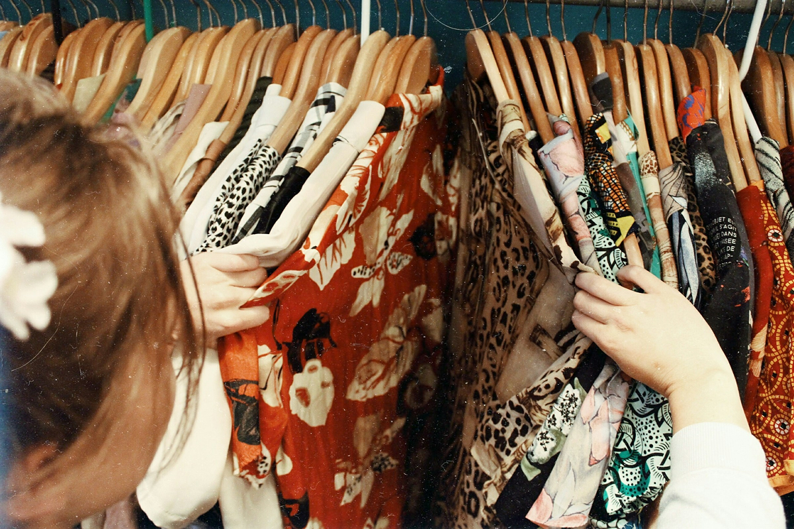

<div align="center">


### Mais vida para o que já existe.

**Um marketplace de compra, venda, troca e doação que aproxima pessoas e incentiva o consumo consciente.**

[](https://reuse-lab.vercel.app)
[](https://youtu.be/6i3HlwCB0co)
[](https://www.figma.com/design/NaexTrfbA7TNhsVIujyBsh/ReUse)

**Projeto acadêmico · Web Design · FIAP · 2026**

</div>

---

<p align="center">
  
</p>

## ♻️ O projeto

Objetos ainda podem ter muitas histórias pela frente. O **ReUse** transforma essa ideia em uma experiência digital: encontrar produtos, anunciar o que não é mais utilizado e iniciar conversas para combinar uma **venda, troca ou doação**.

O projeto reúne experiências **Web e Mobile** com linguagem visual consistente, diferentes percursos de navegação e um domínio de dados compartilhado.

> **Contexto de demonstração:** este é um projeto acadêmico. Anúncios, perfis, preços, localidades e interações usados na demonstração são fictícios; não representam ofertas ou negociações reais. O acesso à versão hospedada pode exigir autorização.

## ✨ Experiências do ReUse

| Experiência | O que oferece |
| :--- | :--- |
| **Descobrir** | Vitrine de produtos, busca, categorias, filtros e páginas de detalhes |
| **Anunciar** | Cadastro, edição e gerenciamento de itens para venda, troca ou doação |
| **Conectar** | Perfis e conversas associadas aos anúncios |
| **Acompanhar** | Notificações e estados de interface para orientar as próximas ações |
| **Assistência** | Integração experimental com IBM watsonx Orchestrate para orientar o usuário e propor ações sobre anúncios próprios, sempre com confirmação |
| **Entre telas** | Aplicação Web responsiva e aplicativo desenvolvido com React Native e Expo |

As funcionalidades dependem do ambiente e dos serviços configurados. A versão Mobile foi exercitada em ambiente de desenvolvimento; isso não equivale à distribuição de um aplicativo publicado nas lojas.

## 🎨 Design com propósito

A identidade do ReUse foi concebida para comunicar sustentabilidade **sem recorrer à estética verde convencional**. A combinação de marrom, creme e rosa/lilás cria uma interface acolhedora, contemporânea e reconhecível.

<p align="center">
  
</p>

### Cores e tipografia

| Cor | Hex | Papel na interface |
| :--- | :--- | :--- |
| Marrom | `#342A2A` | Marca, navegação e hierarquia |
| Petróleo / marrom secundário | `#584C4C` | Elementos de apoio |
| Creme | `#F7EFDE` | Fundos e áreas de respiro |
| Rosa | `#EBBBEB` | Chamadas e destaques |

**Syne ExtraBold** dá personalidade à marca; **Inter** prioriza a legibilidade dos textos e controles.

<p align="center">
  
</p>

<p align="center">
  
</p>

### UX/UI e acessibilidade

A experiência prioriza **visibilidade do estado do sistema**, **controle do usuário** e **consistência** entre plataformas. Entre os cuidados adotados estão feedback de processamento e erro, ações com confirmação ou cancelamento, rótulos identificáveis e áreas de toque adequadas.

<p align="center">
  
</p>

## 🧩 Tecnologia e arquitetura

A aplicação combina dois clientes e um backend compartilhado:

```text
Web: Next.js / React ─────┐
                           ├── API Next.js / Prisma ── Supabase
Mobile: React Native ─────┘                        └─ Auth, PostgreSQL e imagens

                          └── IBM watsonx Orchestrate
                              (assistência com confirmação do usuário)
```

| Camada | Tecnologias principais |
| :--- | :--- |
| **Web** | Next.js, React |
| **Mobile** | React Native, Expo, TypeScript |
| **Backend e dados** | APIs Next.js, Prisma, PostgreSQL |
| **Autenticação e arquivos** | Supabase |
| **Assistência conversacional** | IBM watsonx Orchestrate |
| **Design** | Figma, design tokens, Syne e Inter |

As integrações externas dependem de credenciais e permissões próprias. A demonstração do assistente IBM ocorreu em contexto acadêmico de trial, não como serviço comercial permanente. Consulte [a documentação do assistente](docs/ibm-assistant.md) e [os limites de validação](docs/validacao.md).

## 🗂️ Organização do repositório

```text
ReUse/
├── apps/
│   ├── web/             # Aplicação Next.js e APIs
│   └── mobile/          # Aplicativo Expo / React Native
├── design/              # Tokens compartilhados
├── docs/                # Documentação técnica e limites
├── scripts/             # Ferramentas e verificações
├── package.json         # npm workspaces
└── package-lock.json
```

Os históricos dos projetos Web e Mobile foram preservados na integração do repositório.

## 🚀 Executar localmente

**Pré-requisitos:** Node.js 24.x e npm 11.x. As aplicações utilizam variáveis de ambiente próprias, documentadas em `apps/web/.env.example` e `apps/mobile/.env.example`. Não use credenciais reais ou ambientes de produção para testes demonstrativos.

```bash
git clone https://github.com/isalvesb/ReUse.git
cd ReUse

npm ci --install-strategy=nested --ignore-scripts
npm run generate:web

# Em terminais separados, após configurar os ambientes:
npm run dev:web
npm run dev:mobile
```

O servidor Web local utiliza `127.0.0.1:4330`. A geração do cliente Prisma **não** executa migrations nem popula o banco.

### Verificações disponíveis

```bash
npm run check
npm run design:check
npm run build:web
npm run build:mobile
```

O último comando exporta bundles para as plataformas móveis; não gera um aplicativo assinado para distribuição.

Para integração de dados, proteção de arquivos, execução de testes e preparação de ambientes, consulte a [documentação técnica](docs/), especialmente [segurança](docs/seguranca.md), [dados demonstrativos](docs/demonstracao-academica.md) e [pré-publicação](docs/pre-publicacao.md).

## 👥 Equipe ReUse

<div align="center">

<table>
<tr>
<td align="center"><a href="https://github.com/guicunhasou"><br /><b>Guilherme Cunha</b></a></td>
<td align="center"><a href="https://github.com/isalvesb"><br /><b>Isamara Alves</b></a></td>
<td align="center"><a href="https://github.com/kaucavalcante"><br /><b>Kauane Cavalcante</b></a></td>
<td align="center"><a href="https://github.com/amimarinho"><br /><b>Mirna Marinho</b></a></td>
</tr>
</table>

**FIAP · Web Design · 2026**

[Site](https://reuse-lab.vercel.app) · [Vídeo pitch](https://youtu.be/6i3HlwCB0co) · [Código-fonte](https://github.com/isalvesb/ReUse)

<sub>Reutilizar começa por uma boa experiência.</sub>

</div>
